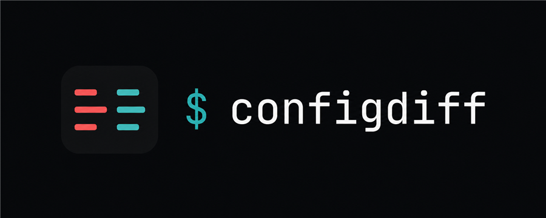
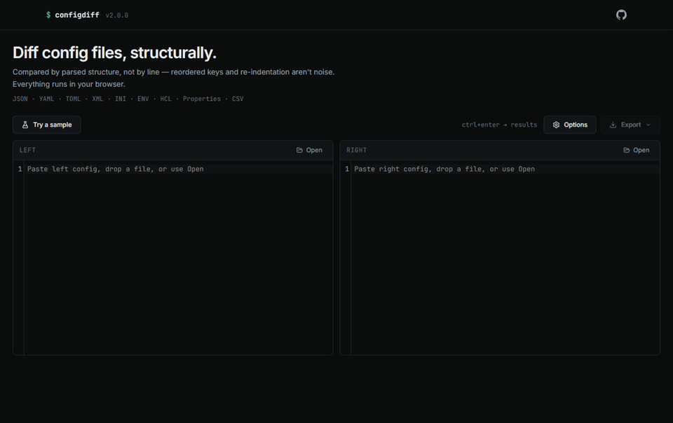

<p align="center">
  
</p>

# SimpleConfigDiff

Diff config files by structure, not by line. A reordered YAML key, a re-indented JSON block, or `"true"` vs `true` isn't a difference worth reading — this tool parses both sides and shows you what actually changed.

Paste or drop two configs into the side-by-side editors and the diff updates as you type. Runs entirely in the browser; files never leave your machine.

**[eladser.github.io/SimpleConfigDiff](https://eladser.github.io/SimpleConfigDiff/)**



## Use it

**In the browser** — [eladser.github.io/SimpleConfigDiff](https://eladser.github.io/SimpleConfigDiff/). Nothing to install, nothing uploaded anywhere.

**As an app** — it's a PWA. In Chrome or Edge, open the site and click the install icon in the address bar. You get a windowed offline app with its own icon.

**CLI, one-off** — no install:

```bash
npx simple-config-diff left.json right.json
```

**CLI, on your PATH:**

```bash
npm install -g simple-config-diff
configdiff app.yaml app.prod.yaml -o summary
```

## Formats

JSON, YAML, TOML, XML, INI, ENV, Java properties, HCL/Terraform, CSV, and generic `.conf` files. You can also diff across formats — a JSON file against its YAML equivalent shows value changes, not syntax noise.

## Views

- Side by side, grouped by parent path, with search, type filters, and character-level highlights inside changed values
- Tree of changes, expandable per section
- Unified diff, suitable for patches

Each row has copy-path / copy-value actions, and an "ignore this key" button that adds an ignore rule and recompares on the spot. Results export to JSON, CSV, HTML, or a patch file.

## Comparison options

- Semantic mode treats `"true"` and `true` as equal
- Ignore specific keys, or whole path patterns (glob, regex, exact)
- Regex value transforms before comparing (e.g. normalize URLs)
- Case, whitespace, and comment handling

## CLI

Built for scripts and CI. Exit code is 1 when differences are found, diff-style, so it works as a check step.

```bash
configdiff left.json right.json                          # colored table
configdiff app.yaml app.prod.yaml -o summary             # counts only
configdiff a.toml b.toml -o json --output-file diff.json # machine-readable
configdiff .env.local .env.prod -w                       # watch mode
```

Useful flags: `-f` forces a format, `--force` compares across different formats, `--ignore-case` / `--ignore-whitespace` relax matching, `--no-color` for logs. `--help` has the rest.

## Development

```bash
git clone https://github.com/eladser/SimpleConfigDiff.git
cd SimpleConfigDiff
npm install
npm run dev      # localhost:3000
npm run build    # type-check + production build
npm run lint
```

React 19, Vite 8, Tailwind 4, TypeScript. Parsers: js-yaml, fast-xml-parser, ini, smol-toml.

## License

MIT
