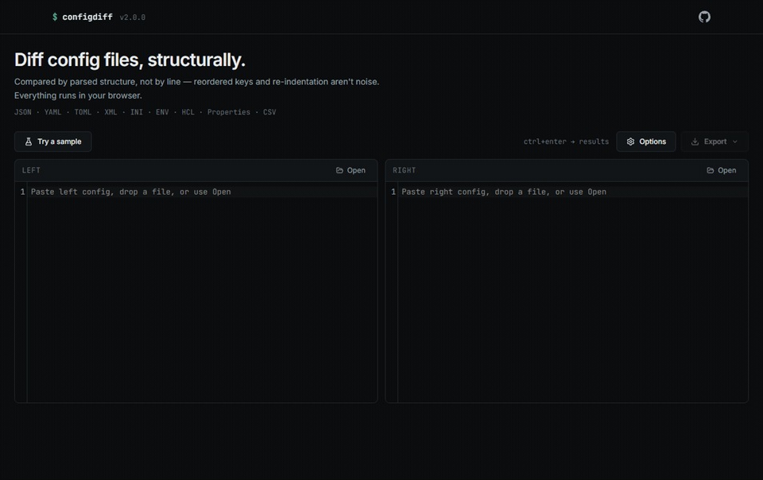

<p align="center">
  
</p>

# SimpleConfigDiff

Diff config files by structure, not by line. A reordered YAML key, a re-indented JSON block, or `"true"` vs `true` isn't a difference worth reading. This tool parses both sides and shows you what actually changed.

Paste or drop two configs into the side-by-side editors and the diff updates as you type. Runs entirely in the browser; files never leave your machine.

**[eladser.github.io/SimpleConfigDiff](https://eladser.github.io/SimpleConfigDiff/)**



## Use it

**In the browser**: [eladser.github.io/SimpleConfigDiff](https://eladser.github.io/SimpleConfigDiff/). Nothing to install, nothing uploaded anywhere.

**As an app**: it's a PWA. In Chrome or Edge, open the site and click the install icon in the address bar. You get a windowed offline app with its own icon.

**CLI, one-off**, no install:

```bash
npx simple-config-diff left.json right.json
```

**CLI, on your PATH:**

```bash
npm install -g simple-config-diff
configdiff app.yaml app.prod.yaml -o summary
```

## Formats

JSON, YAML, TOML, XML, INI, ENV, Java properties, HCL/Terraform, CSV, and generic `.conf` files. You can also diff across formats: a JSON file against its YAML equivalent shows value changes, not syntax noise.

## Views

- Side by side, grouped by parent path, with search, type filters, and character-level highlights inside changed values
- Tree of changes, expandable per section
- Unified diff, suitable for patches

Each row has copy-path / copy-value actions, and an "ignore this key" button that adds an ignore rule and recompares on the spot. Results export to JSON, CSV, HTML, or a patch file.

To share a diff, click "Copy link" in the header. Both configs and your comparison options go into the link's `#` fragment, which browsers never send to a server, and opening the link brings back the same diff. The link holds both files in full, so secret masking doesn't apply to it.

## Comparison options

- Semantic mode treats `"true"` and `true` as equal
- Ignore specific keys, or whole path patterns (glob, regex, exact)
- Regex value transforms before comparing (e.g. normalize URLs)
- Case, whitespace, and comment handling

Values under keys like `password`, `token`, or `api_key` show as dots in every view and export. They're still compared, so a changed password still counts as a change. "Show secrets" reveals them; it's off on every load, and while anything is masked the raw view stays hidden until you turn it on.

## CLI

Built for scripts and CI. Exit code is 1 when differences are found, diff-style, so it works as a check step.

```bash
configdiff left.json right.json                          # colored table
configdiff app.yaml app.prod.yaml -o summary             # counts only
configdiff a.toml b.toml -o json --output-file diff.json # machine-readable
configdiff .env.local .env.prod -w                       # watch mode
configdiff app.json app.prod.json --ignore 'build.*'     # skip matching paths
```

Useful flags: `-f` forces a format, `--force` compares across different formats, `--ignore-case` / `--ignore-whitespace` relax matching, `--no-color` for logs. `--help` has the rest.

`--ignore` takes a dotted path from the root or a glob, and can be repeated. `*` stays inside one key, `**` crosses levels, and array items count as keys, so `servers.*.host` works. An ignored path drops out of the output and the exit code, along with everything under it. Rules you want on every run can live in `.configdiffrc.json` in the working directory, and they add up with any `--ignore` flags:

```json
{ "ignore": ["version", "build.*"] }
```

Secret values print as dots here too, in every output format and in `--output-file`, but still count toward the exit code. `--show-secrets` prints them as they are.

## Development

```bash
git clone https://github.com/eladser/SimpleConfigDiff.git
cd SimpleConfigDiff
npm install
npm run dev      # localhost:3000
npm run build    # type-check + production build
npm run lint
```

React 19, Vite 8, Tailwind 4, TypeScript. Parsers: js-yaml, fast-xml-parser, ini, smol-toml.

## Support

If this tool saved you some time, you can [buy me a coffee](https://ko-fi.com/eladser).

## License

MIT
